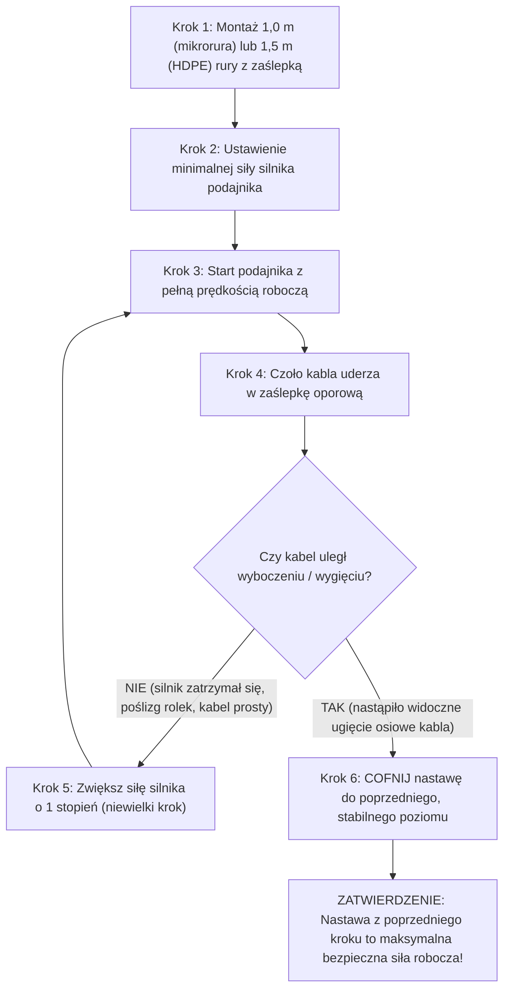

# Baza Wiedzy: Metody Wdmuchiwania Kabli i Procedura Crash-Test

## Metadata
- **Źródło**: „Budowa nowoczesnych sieci telekomunikacyjnych z zastosowaniem techniki wdmuchiwania kabli światłowodowych”, autor: mgr inż. Michał Andrzejewski (GAMM-BUD / Blue Dragon Jet), Rozdziały 6 i 14.
- **Kategoria**: Metody Wdmuchiwania, Procedury Operacyjne, Crash-Test, Metoda Strumieniowa, Metoda Tłoczkowa, Postępowanie Awaryjne
- **Słowa kluczowe**: metoda strumieniowa, Jetting, metoda tłoczkowa, Piston, crash-test, próba zderzeniowa, wyboczenie kabla, głowica pilotująca, mosiężny pocisk, lubrykant kablowy, relaksacja naprężeń, tarcie statyczne, awaryjne zatrzymanie kabla

---

## 1. Przegląd Metod Pneumatycznego Wprowadzania Kabli

W praktyce inżynieryjnej stosuje się dwie podstawowe metody wdmuchiwania światłowodów różniące się zasadą fizyczną wytwarzania siły ciągnącej:

| Parametr / Cecha | Metoda Strumieniowa (Jetting / Inflow) | Metoda Tłoczkowa (Piston / Shuttling) |
|:---|:---|:---|
| **Zasada fizyczna** | Tarcie wzdłużne opływającego strumienia powietrza o płaszcz kabla (efekt lepkości) | Różnica ciśnień powietrza działająca bezpośrednio na powierzchnię czołową tłoczka |
| **Element czołowy kabla** | Zaokrąglona głowica pilotująca (tzw. mosiężny pocisk / bullet head) | Szczelny tłoczek poliuretanowy, gumowy lub kielichowy (spadochron) |
| **Średnice kabli** | Od $0{,}5\text{ mm}$ do $20\text{ mm}$ | Od $9\text{ mm}$ do $34\text{ mm}$ |
| **Średnice rurociągów** | Od mikrorur $4\text{ mm}$ do rur $50\text{ mm}$ | **Wyłącznie rurociągi o średnicy wewnętrznej $ID > 20\text{ mm}$** (zazwyczaj HDPE 32, 40, 50 mm) |
| **Zastosowanie w mikrokanalizacji** | **TAK – podstawowa i jedyna dozwolona metoda** | **BEZWZGLĘDNIE ZABRONIONA w mikrorurach!** |
| **Maksymalna prędkość** | Zazwyczaj $40 – 80\text{ m/min}$ | Do $120 – 130\text{ m/min}$ (w łukach max $60\text{ m/min}$) |
| **Rola podajnika wdmuchiwarki** | Równomierne pchanie kabla przez cały czas wdmuchiwania | Asysta prędkości, kontrola bębna, pchanie włączane dopiero przy spadku prędkości $< 30\text{ m/min}$ |

---

## 2. Metoda Strumieniowa (Jetting) – Procedura Krok po Kroku

Metoda strumieniowa polega na wprowadzeniu kabla do komory wdmuchującej i podaniu sprężonego powietrza, które pędzi z dużą prędkością w szczelinie pierścieniowej między kablem a ścianką rury.

### 2.1. Przygotowanie Kabla i Osprzętu
1. Na czoło kabla zakłada się zaokrągloną mosiężną głowicę prowadzącą (pocisk), zabezpieczoną śrubami imbusowymi lub zaciśniętą na powłoce zewnętrznej. Głowica chroni włókna przed rozerwaniem pędem powietrza i zapobiega wbijaniu się ostrego czoła kabla w ścianki lub złączki.
2. **Zasada stosowania płynów poślizgowych (lubrykantów)**:
   - Dla kabli i mikrokabli o średnicy **$> 1{,}5\text{ mm}$**: obowiązkowe stosowanie certyfikowanego płynu poślizgowego (wstępne gąbkowanie rury lub ciągłe podawanie przez lubrykator).
   - Dla włókien i mikrokabli cienkich **$\le 1{,}5\text{ mm}$**: **BEZWZGLĘDNY ZAKAZ stosowania płynów poślizgowych!** Lepkość lubrykantu powoduje przyklejenie lekkiego włókna do ścianki rurki i natychmiastowe zablokowanie.

### 2.2. Etapy Wdmuchiwania Strumieniowego
1. **Pchanie wstępne bez powietrza**:
   - Wprowadzić kabel do komory wdmuchiwarki i uruchomić podajnik mechaniczny (pasy/rolki) z prędkością ok. $40 – 60\text{ m/min}$ **BEZ OTWIERANIA ZAWORU POWIETRZA**.
   - Wprowadzić tak pierwsze kilkadziesiąt metrów (często do 100–200 m), wykorzystując wyłącznie mechaniczną siłę posuwu.
2. **Podanie ciśnienia początkowego**:
   - W momencie, gdy prędkość zaczyna spadać, otworzyć główny zawór sprężarki, ustawiając ciśnienie początkowe na poziomie **$\le 2\text{ bar}$**.
3. **Stopniowe podnoszenie ciśnienia**:
   - W miarę oddalania się czoła kabla i narastania długości odcinka w rurociągu, podnosić ciśnienie skokowo co **$1\text{ bar}$** (np. 3 bar, 4 bar, 6 bar, aż do 10–15 bar).
   - Płynny wzrost ciśnienia pozwala na optymalne uformowanie poduszki aerodynamicznej wzdłuż całego kabla.

---

## 3. Metoda Tłoczkowa (Piston) – Procedura Krok po Kroku

Stosowana wyłącznie w tradycyjnej kanalizacji wtórnej (rury HDPE 32, 40, 50 mm) dla kabli o masie powyżej $100\text{ kg/km}$.

### 3.1. Przygotowanie Tłoczka i Lubryfikacja
1. Na czoło kabla montuje się szczelny tłoczek dopasowany do średnicy wewnętrznej rury (z krętlikiem zapobiegającym skręcaniu kabla).
2. **Dozowanie lubrykantu**:
   - Przed tłoczkiem wlewa się do rury ok. **$0{,}5\text{ litra}$** płynu poślizgowego.
   - Dodatkowo przygotowuje się naddatek: **$1\text{ litr}$ płynu na każdy $1\text{ km}$** planowanej trasy rurociągu.

### 3.2. Przebieg Wdmuchiwania Tłoczkowego
1. Zamknąć komorę wdmuchiwarki i podać powietrze pod ciśnieniem 4–8 bar.
2. Tłoczek pod wpływem siły parcia natychmiast rusza w głąb rurociągu, ciągnąc za sobą kabel.
3. **Reżim prędkości**:
   - Maksymalna dopuszczalna prędkość tłoczka na prostych wynosi **$120 – 130\text{ m/min}$**.
   - Na zakrętach, łukach i przed studniami prędkość należy zdławić do maks. **$60\text{ m/min}$**.
   - Wdmuchiwarka początkowo pełni rolę hamulca podającego kabel z regulowanym oporem, zapobiegając niekontrolowanemu rozwijaniu bębna.
4. **Załączenie napędu pchającego podajnika**:
   - W miarę narastania długości kabla siła tarcia rośnie. Gdy prędkość posuwu spadnie poniżej **$30\text{ m/min}$**, operator włącza silnik podajnika wdmuchiwarki, dodając siłę pchającą $F_p$ do siły naciągu tłoczka.

---

## 4. Procedura Wykonania Próby Zderzeniowej (Crash-Test)

> [!CRITICAL]
> **Definicja i Cel Crash-Testu**:
> Crash-Test to obowiązkowa próba kalibracyjna wykonywana przed każdym wdmuchiwaniem. Ma na celu wyznaczenie maksymalnej dopuszczalnej siły docisku i posuwu podajnika wdmuchiwarki, przy której **kabel nie ulegnie wyboczeniu (złamaniu/zgięciu sprężystemu wewnątrz komory)** w przypadku nagłego, twardego zablokowania czoła w rurociągu.

### 4.1. Przygotowanie Stanowiska Testowego
1. Do głowicy wdmuchiwarki podłącza się krótki odcinek rury testowej (dokładnie takiej samej, jaka leży w wykopie):
   - Dla rurociągów wtórnych HDPE (32, 40, 50 mm): odcinek o długości **$1{,}5\text{ m}$**.
   - Dla mikrokanalizacji (mikrorury 5–16 mm): odcinek o długości **$1{,}0\text{ m}$**.
2. Wolny koniec rury testowej zamyka się sztywnym korkiem zaślepiającym (zaślepką oporową wytrzymującą napór osiowy).
3. Do podajnika wdmuchiwarki wprowadza się $3 – 4\text{ m}$ kabla z bębna roboczego.

### 4.2. Algorytm Przeprowadzenia Crash-Testu

1. **Uruchomienie**: Ustawić regulator siły pchającej na wartość minimalną. Uruchomić silnik podajnika z prędkością roboczą w kierunku zaślepki.
2. **Uderzenie**: Czoło kabla uderza w korek zaślepiający. Podajnik zatrzymuje się, a silnik wchodzi w bezpieczny stan utyku (slip) lub rolki bezpiecznie ślizgają się po kablu bez niszczenia powłoki.
3. **Zwiększanie siły**: Jeżeli kabel zachował idealną prostoliniowość, cofnąć kabel, zwiększyć nastawę siły o mały krok (np. o 0,5 bar na zaworze hydraulicznym lub potencjometrem elektrycznym) i powtórzyć próbę.
4. **Wykrycie granicy wyboczenia**: Powtarzać test do momentu, w którym po uderzeniu w korek zaobserwuje się pierwsze mikroskopijne ugięcie lub sfalowanie kabla w komorze wdmuchującej.
5. **Ustalenie limitu**: Maksymalną dopuszczalną siłę roboczą wdmuchiwarki ustawia się na wartość z **poprzedniego, w pełni stabilnego kroku**. Zapewnia to 100% gwarancji, że w razie napotkania przeszkody w rurociągu kabel nie zostanie zniszczony!

---

## 5. Procedura Awaryjna przy Nagłym Zatrzymaniu Kabla

Gdy kabel podczas wdmuchiwania nagle zwolni lub zatrzyma się w rurociągu, operator musi bezwzględnie zastosować poniższy protokół awaryjny:

1. **Natychmiastowe wyłączenie napędu podajnika**:
   - Bezzwłocznie zatrzymać silnik posuwu wdmuchiwarki, aby zapobiec przetarciu powłoki kabla przez kręcące się w miejscu rolki/pasy lub jego wyboczeniu.
2. **Dekompresja rurociągu**:
   - Zamknąć dopływ sprężonego powietrza i otworzyć zawór spustowy na komorze wdmuchującej, spuszczając całe ciśnienie z rurociągu do zera.
3. **ZASADA 5 MINUT (Relaksacja Naprężeń i Redukcja Tarcia)**:
   > [!IMPORTANT]
   > Po dekompresji należy **BEZWZGLĘDNIE ODCZEKAĆ MINIMUM 5 MINUT** przed podjęciem jakiejkolwiek ponownej próby ruszenia kabla!
   > **Uzasadnienie inżynieryjne**:
   > - Współczynnik tarcia statycznego ($\mu_s$) jest niemal dwukrotnie wyższy niż tarcia dynamicznego ($\mu_d$).
   > - Wewnątrz rurociągu powstały skumulowane sprężyste naprężenia wzdłużne i zafalowania powłoki kabla.
   > - Czas 5 minut pozwala na termiczne i sprężyste rozprężenie (relaksację) tworzywa HDPE kabla i rury, co powoduje samoczynne wyprostowanie osi kabla i gwałtowny spadek sił oporu.
4. **Ponowny start sekwencyjny**:
   - Po upływie 5 minut uruchomić podajnik mechaniczny z ograniczoną siłą **BEZ POWIETRZA** na 2–3 sekundy, aby zerwać tarcie spoczynkowe.
   - Gdy kabel drgnie i zacznie posuwać się do przodu, bardzo powoli otwierać zawór sprężonego powietrza (od 1–2 bar w górę), synchronizując wzrost ciśnienia z ruchem posuwistym.
