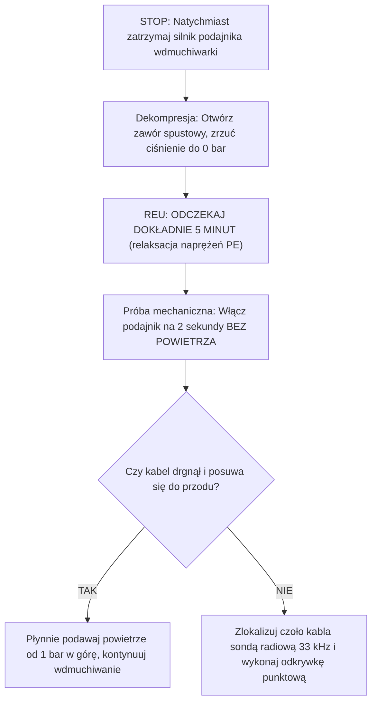

# Baza Wiedzy: Błędy Wdmuchiwania, Matryca Diagnostyczna i Troubleshooting

## Metadata
- **Źródło**: „Budowa nowoczesnych sieci telekomunikacyjnych z zastosowaniem techniki wdmuchiwania kabli światłowodowych”, autor: mgr inż. Michał Andrzejewski (GAMM-BUD / Blue Dragon Jet), Rozdział 11.
- **Kategoria**: Diagnostyka Problemów, Troubleshooting, Błędy Wykonawcze, Algorytm Awaryjny, Przyczyny Zablokowania Kabla
- **Słowa kluczowe**: troubleshooting wdmuchiwania, zablokowanie kabla, wyboczenie światłowodu, matryca diagnostyczna, utknięcie kabla, dekompresja rurociągu, relaksacja naprężeń, balonowanie rury, wióry w rurociągu

---

## 1. Cztery Główne Kategorie Błędów Wykonawczych

Analiza setek nieudanych operacji wdmuchiwania wskazuje na cztery główne źródła problemów technicznych:

### 1.1. Błędy Przygotowania Trasy i Rurociągu (Kategoria I)
- **Brak próby ciśnieniowej i kalibracji**: Przystąpienie do wdmuchiwania „w ciemno” bez uprzedniego przedmuchania wałka kalibracyjnego ($\ge 90\%$ ID) lub stalowej kulki kalibracyjnej ($80–90\%$ ID).
- **Zadziory i wióry po cięciu**: Użycie piły do metalu lub noża zamiast obcinaka krążkowego. Ostre wióry tworzywa zbierają się przed głowicą kabla i tworzą nieprzejezdny czop.
- **Brak podsypki i kamienie polne**: Wgniecenie rury przez kamień w wykopie pod wpływem ciężaru ziemi lub przejeżdżających pojazdów (owalizacja rurociągu).
- **Zanieczyszczenia chemiczne i płuczka bentonitowa**: Pozostawienie niezabezpieczonych końców rurociągu w wykopie, zalanie mułem lub płuczką HDD.

### 1.2. Błędy Doboru i Obsługi Kabla (Kategoria II)
- **Nieprawidłowy stopień wypełnienia ($K_d$)**:
  - $K_d > 75\%$: Zdławienie przepływu sprężonego powietrza, brak poduszki aerodynamicznej.
  - $K_d < 35\%$: Zbyt wiotki kabel w dużej rurze – kabel ulega zjawisku helisy (wężowania) i wyboczeniu.
- **Stosowanie lubrykantu na mikrowłóknach $\le 1{,}5\text{ mm}$**: Sklejenie włókna z rurką i zablokowanie na pierwszych kilkunastu metrach.
- **Niezachowanie czystości zwojów kabla**: Rozwijanie kabla bezpośrednio na piaszczystej lub błotnistej nawierzchni zamiast na plandece lub z odwijaka bębnowego. Brudny kabel działa jak papier ścierny niszczący powłokę ślizgową rurociągu.

### 1.3. Błędy Sprzętu Pneumatycznego (Kategoria III)
- **Brak chłodnicy końcowej (aftercoolera)**: Podanie powietrza o temperaturze $> 90^\circ\text{C}$ prosto z kompresora śrubowego. Skutkuje to zjawiskiem balonowania rury, rozmiękczeniem tworzywa i zatarciem kabla.
- **Brak osuszacza w temperaturach $< +5^\circ\text{C}$**: Wykroplona woda zamarza w komorze wdmuchującej i w silniku pneumatycznym wdmuchiwarki, unieruchamiając napęd.
- **Niedopasowanie wydatku do średnicy rury**: Próba wdmuchiwania w rurę HDPE 40 mm sprężarką o wydatku $1{,}5\text{ m}^3\text{/min}$ (wymagane min. $10\text{ m}^3\text{/min}$).

### 1.4. Błędy Procedury i Operatora (Kategoria IV)
- **Zaniechanie próby zderzeniowej (Crash-Test)**: Ustawienie maksymalnej siły podajnika „na oko”, co przy napotkaniu przeszkody kończy się zgnieceniem i połamaniem włókien.
- **Gwałtowne otwarcie pełnego ciśnienia**: Otwarcie zaworu 15 bar od samego początku zamiast startu bez powietrza i stopniowego podnoszenia ciśnienia o 1 bar.
- **Pchanie zablokowanego kabla na siłę**: Próba forsowania zatoru pełną mocą podajnika po zatrzymaniu czoła kabla.

---

## 2. Matryca Rozwiązywania Problemów (Troubleshooting Matrix)

Poniższa tabela stanowi przewodnik diagnostyczny na wypadek wystąpienia nieprawidłowości w trakcie wdmuchiwania:

| Objaw awarii | Prawdopodobna przyczyna | Działanie naprawcze / Krok inżynieryjny |
|:---|:---|:---|
| **Kabel zatrzymuje się na pierwszych 20–80 metrach** | 1. Zbyt mały promień gięcia na wejściu do wykopu ($R < 1{,}5\text{ m}$). 2. Brak głowicy pilotującej (czoło kabla uderzyło w krawędź pierwszej złączki). 3. Złączka push-fit nie była wciśnięta do oporu. | 1. Zapewnić łagodne wejście kabla w rurociąg (łuk $R > 2{,}5\text{ m}$). 2. Zamontować mosiężną głowicę pociskową na czole kabla. 3. Skontrolować i poprawić pierwszą złączkę za wyjściem ze studni. |
| **Kabel nagle zatrzymuje się w połowie trasy (twardy opór)** | 1. Kamień wbił się w ściankę rury (zgniot przekroju). 2. Rozpięcie złączki w gruncie pod naporem ciśnienia. 3. Nieusunięty czop bentonitowy po wierceniu HDD. | 1. Natychmiast wyłączyć napęd i zrzucić ciśnienie. 2. Zlokalizować czoło kabla odbiornikiem radiowym (sonda 33 kHz). 3. Wykonać punktowy wykop kontrolny w miejscu zatoru. |
| **Kabel stopniowo zwalnia, a ciśnienie na wdmuchiwarce rośnie do maksimum** | 1. Przegrzanie rurociągu (brak chłodnicy aftercooler). 2. Zbyt duży stopień wypełnienia rury ($K_d > 75\%$). 3. Rurociąg suchy – brak lub wyczerpanie filmu płynu poślizgowego. | 1. Natychmiast włączyć chłodnicę końcową sprężarki. 2. Odczekać 5 minut na ostygnięcie i rozprężenie rury. 3. Założyć lubrykator i podać ciągły natrysk płynu poślizgowego. |
| **Podajnik ślizga się po kablu lub niszczy zewnętrzną powłokę** | 1. Zbyt słaby lub zbyt mocny docisk rolek/pasów. 2. Rolki zabrudzone płynem poślizgowym lub błotem. 3. Profil rolek niedopasowany do średnicy kabla. | 1. Oczyścić bieżnie rolek alkoholem izopropylowym (IPA). 2. Skorygować siłę docisku rolek zgodnie z wynikiem Crash-Testu. 3. Wymienić wkładki/rolki podajnika na dedykowane dla danego kabla. |
| **Silnik pneumatyczny wdmuchiwarki traci moc lub zamarza** | 1. Temperatura otoczenia $< +5^\circ\text{C}$ i brak osuszacza. 2. Brak zasilania mgłą olejową z naolejacza. | 1. Zainstalować osuszacz ziębniczy lub adsorpcyjny. 2. Uzupełnić olej pneumatyczny w naolejaczu silnika. |

---

## 3. Protokół Postępowania w Sytuacji Awaryjnego Utyku Kabla

W przypadku zablokowania kabla w rurociągu obowiązuje bezwzględny, 6-krokowy protokół ratunkowy:

1. **KROK 1 (STOP)**: Natychmiast wyłączyć napęd wdmuchiwarki. Kręcące się w miejscu rolki w ułamku sekundy zetrą płaszcz kabla do włókien.
2. **KROK 2 (Dekompresja)**: Zamknąć zasilanie ze sprężarki i całkowicie odpowietrzyć rurociąg do poziomu 0 bar przez zawór upustowy komory wdmuchującej.
3. **KROK 3 (Zasada 5 Minut)**: Odczekać minimum 5 minut w stanie całkowitego braku ciśnienia. Tworzywo HDPE ulega relaksacji termomechanicznej, ugaszeniu ulegają fale sprężyste wzdłuż rurociągu, a współczynnik tarcia spoczynkowego maleje.
4. **KROK 4 (Impuls zerwania tarcia)**: Uruchomić podajnik wdmuchiwarki z umiarkowaną siłą **BEZ OTWIERANIA POWIETRZA** na czas 2–3 sekund. Ma to na celu przełamanie tarcia statycznego.
5. **KROK 5 (Płynna asysta ciśnieniowa)**: Jeżeli kabel ruszy, natychmiast delikatnie otwierać zawór powietrza, podnosząc ciśnienie od 1–2 bar w górę wraz z ruchem kabla.
6. **KROK 6 (Namierzenie zatoru)**: Jeżeli po 5 minutach kabel ani drgnie, nie stosować siły zagrażającej zniszczeniem światłowodu. Za pomocą lokalizatora namierzyć sondę 33 kHz na czole kabla, dokonać punktowego nacięcia rury w wykopie, usunąć przyczynę blokady i połączyć rurociąg złączką gazoszczelną.
